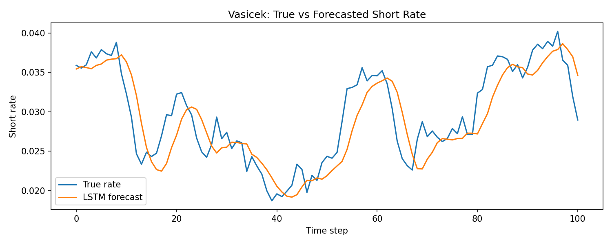
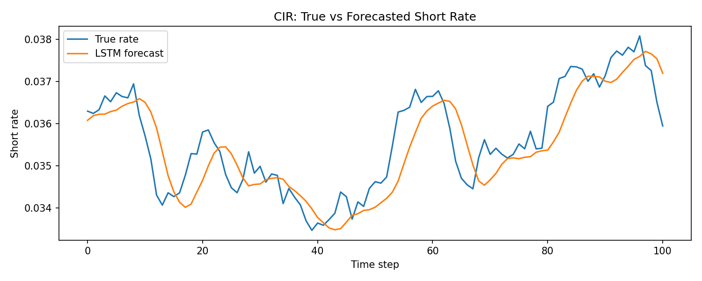

# Short-Rate Forecasting: Vasicek & CIR Models + LSTM

Course project (MS3610) simulating mean-reverting short-term interest rate dynamics with the **Vasicek** and **Cox-Ingersoll-Ross (CIR)** stochastic models, then forecasting the simulated rates with an **LSTM** neural network.

## Overview

- Simulate short-rate paths with the Vasicek and CIR models (Euler-Maruyama discretization).
- Frame the simulated series as a supervised learning problem with a sliding lag window.
- Train an LSTM to produce one-step-ahead forecasts.
- Evaluate forecast accuracy with **MAE**, **RMSE**, and **MAPE**, and plot true vs. predicted rates.

## Models

**Vasicek**

```
dr_t = a(b - r_t) dt + sigma * dW_t
```
Simple and analytically tractable, but can produce negative rates.

**Cox-Ingersoll-Ross (CIR)**

```
dr_t = a(b - r_t) dt + sigma * sqrt(r_t) * dW_t
```
Keeps rates non-negative provided the Feller condition `2ab >= sigma^2` holds.

Where `a` = speed of mean reversion, `b` = long-run mean rate, `sigma` = volatility, `dW_t` = Wiener increment.

## Results

Simulation parameters: `r0=0.03, a=0.10, b=0.05, sigma=0.02, T=5yrs, dt=0.01`, 80/20 train-test split, LSTM with a 10-step lag window, 20 epochs.

| Series  | MAE     | RMSE    | MAPE  |
|---------|---------|---------|-------|
| Vasicek | 0.00245 | 0.00310 | 8.53% |
| CIR     | 0.00052 | 0.00066 | 1.47% |

The CIR-simulated series (which stays farther from zero under these parameters) is forecast more accurately than the Vasicek series. Exact figures vary slightly run-to-run due to simulation randomness and LSTM weight initialization; re-run `src/main.py` to reproduce with the fixed seed (`SEED=42`), or see `results/metrics.json` for the last generated run.




## Project Structure

```
.
├── notebooks/
│   └── Short_Rate_Forecasting_Vasicek_CIR.ipynb   # walkthrough notebook
├── src/
│   ├── rate_models.py      # Vasicek & CIR simulators
│   ├── lstm_forecast.py    # data prep, LSTM build/train/forecast
│   ├── evaluate.py         # MAE / RMSE / MAPE
│   └── main.py             # end-to-end pipeline (run this)
├── results/
│   ├── vasicek_forecast.png
│   ├── cir_forecast.png
│   └── metrics.json
├── requirements.txt
└── README.md
```

## Getting Started

```bash
git clone https://github.com/<your-username>/short-rate-forecasting.git
cd short-rate-forecasting
pip install -r requirements.txt
```

Run the full pipeline (simulate → train → evaluate → save plots):

```bash
python src/main.py
```

Or explore step-by-step in the notebook:

```bash
jupyter notebook notebooks/Short_Rate_Forecasting_Vasicek_CIR.ipynb
```

## Tech Stack

Python, NumPy, scikit-learn, TensorFlow / Keras (LSTM), Matplotlib.

## Notes

This project uses **simulated** data to study model behavior and forecastability under controlled dynamics; performance on real historical rate data may differ and would need re-tuning of the lag window, LSTM architecture, and training schedule.
